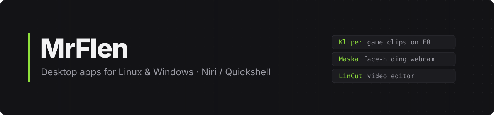

Hi, I'm **MrFlen** from Estonia. I build desktop apps that I couldn't find on Linux,
and make them work on Windows too. Daily driver: CachyOS + Niri.

*Привет! Делаю программы для Linux и Windows, которых мне самому не хватало.*

## Projects

<table>
<tr>
<td width="50%" valign="top">

### [Kliper](https://github.com/Flenstick/kliper-releases)
Instant replay like Medal, without ads or accounts. Press <kbd>F8</kbd> and
the last 30 seconds become a clip. CS2 kill markers, trimming, Discord upload.

</td>
<td width="50%" valign="top">

### [Maska](https://github.com/Flenstick/maska)
A webcam that hides your face: blur, pixels, or your own mask from an image,
GIF or video. Works as a virtual camera in Discord, OBS and the browser.

</td>
</tr>
<tr>
<td width="50%" valign="top">

### [LinCut](https://github.com/Flenstick/lincut)
A CapCut-style video editor for Linux and Windows: effects, keyframes,
masks, Track Matte, AI object cutout, YouTube/TikTok import.

</td>
<td width="50%" valign="top">

### [TrollOS](https://github.com/Flenstick/TrollOS-Dotfiles)
My Niri + Quickshell desktop for CachyOS / Arch. A fork of
[AngelOS-Dotfiles](https://github.com/MixaDoDs/AngelOS-Dotfiles) with its own look,
fixes and plugins.

</td>
</tr>
</table>

## Tools I use

If something I made is useful to you, a ⭐ on the repo helps a lot.
